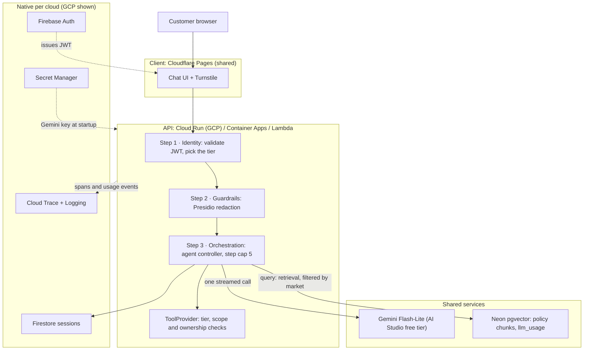
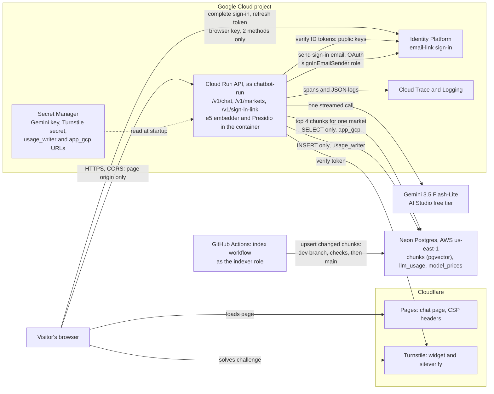
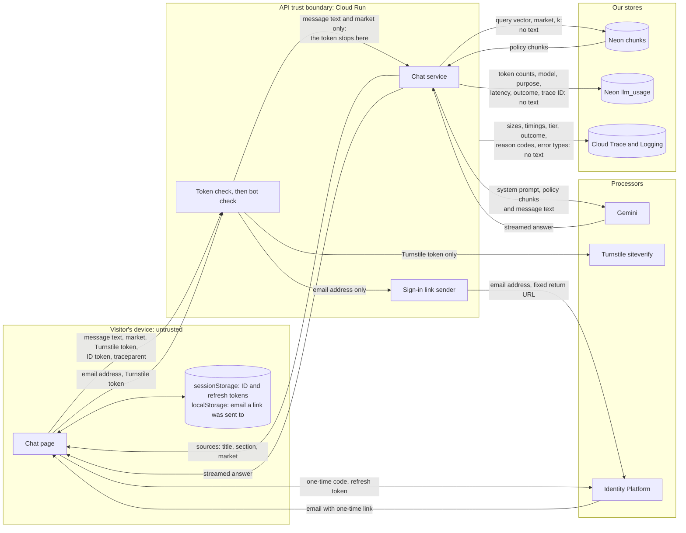
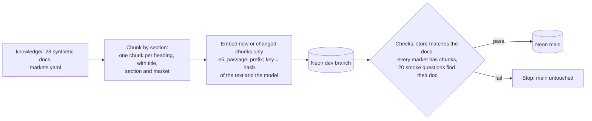
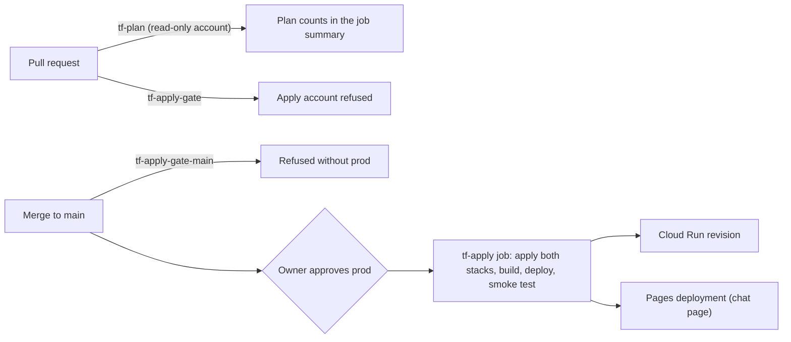

# Design: Spanish support chatbot

Nov 3, 2026 · @Victor Ramirez · Status: living document, updated for M2 (`v0.2.0`)

This doc explains how the system works and why it is shaped this way. Scope and schedule live in
the [roadmap](roadmap.md); individual decisions live in the [ADRs](adr/README.md). Each section
says what is **live** today and what is **designed** but not built yet.

## 1. Problem

A bank serving Spanish speakers in the US, Mexico, Colombia, El Salvador, Peru and Spain wants a
support assistant that:

- answers from **that market's** policy documents, with sources, in regional Spanish
- takes simple account actions (card status, block a card, open a ticket), but only with proof of
  identity and an explicit confirmation
- hands off to a human when it is unsure

The bank is fictional and every customer record is synthetic. The system has to cost **$0 to
run** and work the same way on GCP, Azure and AWS, with only adapters changing between clouds.

## 2. Requirements

The full table, with the milestone that delivers each requirement, is in the
[roadmap](roadmap.md#requirements). The ones that shape the design most:

| Requirement | Target | What it forces |
| --- | --- | --- |
| Answers start fast | First token in under 3 s | One model call on the hot path, no router model, thinking off |
| Identity | JWT checked on every call; three tiers | An identity layer in front of everything, not bolted onto tools |
| Privacy | No PII reaches the model | Redaction right after the token check, before any other step sees the text |
| Cost visibility | Tokens per call by cloud, model and purpose | Usage recorded inside the `LLMProvider` adapter, not in callers |
| Scale | 50k conversations a day | Stateless serving that scales out; state in a session store |
| Cost to run | $0 | Serverless, scale to zero, always-free tiers only |
| Portability | Same app on three clouds | A cloud-free core behind ports ([ADR 0001](adr/0001-monorepo.md)) |

## 3. Architecture

The client, guardrails, orchestration, model and knowledge layers are shared by every cloud.
Identity, serving, sessions, telemetry and secrets are native to each cloud, behind adapters.

The diagram below is the **target design** across all milestones. What runs today is in
[3.1](#31-live-system-today) and [3.2](#32-data-flow-and-trust-boundaries).



The per-cloud mapping of every layer is in the [roadmap](roadmap.md#architecture-decisions).

### 3.1 Live system today

Only what is deployed and running, as of `v0.2.0` plus M3's first slices: redaction of the
message and of the answer is live; sessions and tools are not built yet.



### 3.2 Data flow and trust boundaries

Every arrow says what crosses the boundary. The rule behind them: **data goes only where it is
needed to answer, and telemetry gets sizes, timings and reason codes, never content.**



| Data | Goes to | Never goes to |
| --- | --- | --- |
| Message text | The API, which embeds it in the container, then Gemini | Neon (only its vector goes there), spans, logs, usage rows. It isn't stored: there are no sessions until M3 |
| Query vector | Neon `chunks`, as the read-only `app_gcp` role, with the market | Logs, spans |
| Policy chunks | The API, then Gemini after the system prompt; their title, section and market go to the page as sources | Spans (only their count and top score) |
| ID token | The API, which verifies it and keeps only `sub`, `auth_time` and the tier | The model, logs, spans |
| Refresh token | The page's `sessionStorage` and Google's token endpoint | The API |
| Email address | The API, then Identity Platform, which sends the link and keeps the account | Logs, spans, error replies, usage rows |
| Turnstile token | The API, then Cloudflare's siteverify; it works once | Logs, spans |
| Usage row | Neon, through the insert-only `usage_writer` role | It has no text, user ID or email |
| Secrets | Secret Manager, read by `chatbot-run` at startup | Terraform state, CI logs, the repo |

Two consequences shape the rest of the design:

- **Gemini sees the message text.** On the free tier, Google may use prompts and answers to
  improve its products, which is one reason every document, test and eval in this project is
  synthetic. Since M3, Presidio redacts each message before retrieval and the model, so names,
  IDs, cards, emails and phone numbers are replaced with placeholders before the text leaves the
  API ([ADR 0008](adr/0008-guardrails-tools-access.md)). The answer is scanned on its way back, so
  an ID the model writes never reaches the page either.
- **The device is untrusted.** Anything the page holds (tokens, the pending email) can be read
  by a script on the page, which is why the CSP allows scripts only from the page itself and
  Turnstile, and why the browser key can do nothing but complete a sign-in.

**Rules that keep it portable** (enforced in CI, not just documented):

- `core/` never imports a cloud SDK, the web framework or the adapters (`import-linter`).
- Each port (`LLMProvider`, `IdentityProvider`, `SessionStore`, `ToolProvider`, ...) has one
  contract test suite that every adapter must pass.
- `apps/` are thin entry points with no business logic.

## 4. Online path: one chat request

**Live today (M1):** the chat page at spanish-support-chatbot.pages.dev sends each message with a
fresh Turnstile token and a `traceparent` it generates, and shows the trace ID under each reply. An
anonymous `POST /v1/chat` reaches Cloud Run, the core adds a fixed Spanish
system prompt, and one Gemini call streams the answer back as server-sent events (`data:` deltas,
then `event: done`). On a provider failure the client gets a generic `model_unavailable` event, and
the log records only the error type and status code.

**Live since M2:** every message carries the visitor's market, chosen on the page from
`GET /v1/markets`. No market is `400 market_required`, and one that isn't in the list is
`400 unknown_market`, both after the token and bot checks and before anything streams. The API
embeds the question with e5 (`query:` prefix) and takes the market's top 4 chunks from Neon,
off the event loop. It sends them first as an `event: sources` (title, section and market, with
no IDs or scores), then makes the same single streamed call with the chunks after the unchanged
system prompt. If retrieval fails, the chat stops with `knowledge_unavailable` instead of answering
without the policy. "I don't know" comes from the prompt, not a score cutoff: correct and
off-topic matches overlap (0.851 vs. 0.874), so the 0.82 threshold drops only noise.

```mermaid
sequenceDiagram
    autonumber
    actor V as Visitor
    participant P as Chat page
    participant T as Turnstile
    participant A as API on Cloud Run
    participant G as Gemini
    participant N as Neon
    participant O as Cloud Trace

    V->>P: types a question, presses Enviar
    P->>T: execute the widget
    T-->>P: fresh single-use token
    P->>A: POST /v1/chat with message, market, Turnstile token, traceparent, optional Bearer token
    A->>A: token check: anonymous, signed in or step-up, else 401
    A->>T: siteverify the Turnstile token
    T-->>A: success and hostname, else 403, or 503 if unreachable
    A->>A: market in the list, else 400; embed the question with e5 (query:)
    A->>N: top 4 chunks for this market, as app_gcp
    N-->>A: policy chunks
    A-->>P: SSE event sources: title, section, market
    A->>G: one streamed call: system prompt, policy chunks and message
    G-->>A: answer chunks, or a safety block
    A-->>P: SSE data deltas, then event done or error
    A->>N: one llm_usage row, after the stream
    A->>O: request span and chat.model span, flushed before the request ends
```

Each request is one trace in Cloud Trace:
- **`POST /v1/chat`** continues the browser's `traceparent`. It records the method, the route, the
  status code, the tier and the outcome (`done`, `error`, `incomplete` or `rejected`). It starts
  before the token check, so a refused token is still one trace, with its reason code.
  It also records `client.check_ms`, how long the page waited for its Turnstile token before
  sending, from the page's `X-Client-Timing` header. That wait happens before the request exists,
  so without it a slow bot check looks like nothing at all. The header is untrusted: only a whole
  number of milliseconds up to two minutes is kept, and anything else is ignored.
- **`chat.retrieval`** is its child (M2). It records the market, `k`, the score threshold, the
  number of chunks returned and the top score, so the time before the model call shows up as its
  own stage.
- **`chat.model`** is its child too. It records the model, the message length, the time to first
  token and the number of chunks.

Spans carry sizes and timings, never message text, and errors only by type. Log lines are JSON
with the trace ID, so Cloud Logging shows them under their trace.

Each model call also writes **one row to `llm_usage`** in Neon:
- **Tokens** come from the provider's own counts: input, cached, output and thinking.
- **The core adds** the model, purpose, prompt-part *names*, latency, time to first token, outcome
  and trace ID.
- **No message text.**
- **The row is written after the answer has streamed,** as the insert-only `usage_writer` role. A
  failed write is logged by error type and never fails the chat.
- **Cost is a query, not a stored number.** The `llm_usage_cost` view applies the dated list price
  in effect that day, for example $0.30 / $2.50 per 1M input / output tokens for Flash-Lite, so even
  free-tier calls show their production "shadow cost".

Two details make every request appear:
- Cloud Run's front end marks most requests "not sampled", so that flag is not trusted.
- Spans are flushed before the request ends, while Cloud Run still allocates CPU.

FastAPI's built-in telemetry is off for both reasons: its span ends too late, and its logs can
include request text.

**Designed (M1 to M3):** each step below is one OpenTelemetry span, so time to first token breaks
down by stage.

| # | Step | Detail | Milestone |
| --- | --- | --- | --- |
| 1 | Edge | Turnstile token checked; the browser sends `traceparent` | M1 |
| 2 | Identity | JWT validated on **every** call; no token means the anonymous tier | M1 |
| 2b | Content safety | Gemini's filters at the strictest threshold for hate, sexual, harassment and dangerous content. A blocked answer becomes a polite Spanish refusal that replaces anything already shown, and is recorded as outcome `blocked` with its categories, never the text. Violent requests are refused by the model itself; an input classifier is decided with the M4 safety set | M1 (live) |
| 3 | Redaction | Presidio with spaCy `es_core_news_md`, in the container with no network call, finds PII; the core replaces an allowlist of types at score ≥ 0.4 with `<TYPE_n>` placeholders: names, email, phone, cards, IBAN, and every market's IDs (US SSN and ITIN, Mexico's CURP and CLABE, El Salvador's DUI, Spain's NIF and NIE; Colombia's cédula and Peru's DNI with their markets). Our IDs must pass their check digits. Places, dates and amounts stay. `reply` only accepts the redacted text, so the query vector is built from it too. If the detector fails the message is refused (`503 guardrails_unavailable`), and a cloud deploy without a detector refuses to start. Logged by type and count, never by value ([ADR 0008](adr/0008-guardrails-tools-access.md)). **The answer is scanned too** as it streams, with the pattern recognizers only (no NER, ~0.6 ms a chunk): the last 64 characters are held back so an ID split across chunks is caught whole, and anything found, or any placeholder the model repeats, becomes «[dato protegido]». A scan failure ends the answer without the held-back text. `chat.time_to_first_text_ms` measures what the hold-back adds to the visitor's wait | M3 (live) |
| 4 | Session | Recent turns loaded from the session store | M3 |
| 5 | Retrieval | multilingual-e5-small, in the container, embeds the question (`query:` prefix); Neon returns the top 4 chunks, **always filtered by market**, with HNSW iterative scans so the filter can't leave too few ([ADR 0007](adr/0007-rag-design.md)) | M2 (live) |
| 6 | Model | One streamed Gemini call; stable system prompt prefix for caching; thinking at minimal | M0 (live) |
| 7 | Tools | Only if the model asks: the tier, scope and ownership checks run before any tool | M3 |
| 8 | Output check | The model's output is scanned for PII as well | M3 |
| 9 | Usage | Tokens, model, `purpose`, `prompt_parts` and latency written async to `llm_usage` | M1 |

A question that needs no tool costs **one model call**, with no router model in front of it.
Agent loops that do need tools are capped at 5 steps.

## 5. Identity and access

The tier is decided from the validated token on each call, never from the conversation.

| Tier | How you get it | What you can do |
| --- | --- | --- |
| Anonymous | No token | Policy answers only |
| Signed in | Valid JWT (email sign-in) | Read-only tools, e.g. card status; can ask for an action, which runs only after step-up ([ADR 0008](adr/0008-guardrails-tools-access.md)) |
| Step-up | Signed in **and** `auth_time` within the last 5 minutes (email code or re-login) | Action tools, e.g. block a card, open a ticket |

Rules every tool follows:

- It checks the caller's scope and that the account belongs to the caller's `sub`.
- Action tools need an explicit "yes" from the user, and write an audit record: who, what, when,
  and the decision.
- The model never sees tokens. Tools return masked data only, e.g. "card ending 4417".
- Staff copilots reach the same tools over MCP in M9, with the same checks. MCP tool descriptions
  and results are treated as untrusted input and pass through the guardrails.

**Live today:** the token check runs on every `POST /v1/chat`, behind the `IdentityProvider`
port.
- **No `Authorization` header** gives the anonymous tier.
- **A token must pass every check** to count:
  - RS256 only, with a key from Google's published Firebase keys
  - issuer and audience equal to the project
  - not expired
  - `sub` and `auth_time` present, and `auth_time` not in the future
- **Anything else gets a 401 before anything streams.** The log records only a reason code,
  never the token.
- **The token stops at the API.** The chat service and the model see only the message.
- **The tier rule lives in `core/identity.py`**, so it's the same on every cloud: step-up means
  signed in within the last 5 minutes. Tools that use the tiers arrive in M3.
- **The JWT checker is generic** (`adapters/shared/jwt_identity.py`). Firebase supplies only its
  key URL, issuer and audience; Entra and Cognito will do the same in M7 and M8.
- **A bot check sits in front of the model.** Each chat message carries a fresh, single-use
  Turnstile token from the page, which the API verifies with Cloudflare:
  - it must have been solved on the chat page's own host
  - missing or invalid gets 403; if Cloudflare is unreachable the message is refused with 503,
    failing closed
  - only the chat page's origin may call the API from a browser (CORS)
- **The deploy job is the one exception.** It sends a Google-signed ID token for `tf-apply` in
  `X-Deploy-Probe`, with a fixed audience. Only an approved `prod` job can mint it, and no shared
  secret exists. That lets the post-deploy smoke test still ask a real question. It stays at the
  anonymous tier, and a bad probe is a 401, not a bypass.
- **The tool rule is live in the `ToolProvider` port** (`core/tools.py`), ahead of the first
  real tool in M3. A tool's kind sets its tier, so it can't be configured per tool:
  - read-only tools need signed-in
  - action tools need step-up **and** a confirmation
  - anonymous callers see none

  Tools get `caller.sub` for ownership checks, never a token. The in-process adapter serves
  customers, and the MCP adapter (M9) has to pass the same contract suite.
- **Signing in is email-link only** (Identity Platform, the engine behind Firebase Auth), so
  there are no passwords and no SMS:
  1. The page asks the API for a one-time link. The API checks Turnstile, then has Identity
     Platform email it, as the runtime account with a role that can only send sign-in emails.
     The link always returns to the chat page.
  2. The link brings the user back to the page.
  3. The page exchanges the code for an ID token.
  4. Each message then carries `Authorization: Bearer` with that token.

  ```mermaid
  sequenceDiagram
      autonumber
      actor V as Visitor
      participant P as Chat page
      participant T as Turnstile
      participant A as API on Cloud Run
      participant I as Identity Platform
      participant M as Visitor's inbox

      V->>P: enters an email, asks for a link
      P->>T: execute the widget
      T-->>P: fresh single-use token
      P->>A: POST /v1/sign-in-link with email and Turnstile token
      A->>T: siteverify the token
      T-->>A: success, else 403 and no email
      A->>I: sendOobCode as chatbot-run, return URL fixed to the chat page
      I->>M: email with a one-time link
      A-->>P: 202 sent
      V->>M: opens the link in the same browser
      M->>P: back to the chat page with a one-time code
      P->>I: signInWithEmailLink with the browser key
      I-->>P: ID token for 1 hour and a refresh token
      P->>P: keeps both in sessionStorage
      Note over P,A: every message now carries Authorization Bearer, step-up for 5 minutes
      P->>I: refreshes the ID token before it expires
  ```

  Details:
  - **Tiers:** a fresh sign-in is the step-up tier for 5 minutes, then signed in.
  - **Where tokens live:** in `sessionStorage`, refreshed before their 1-hour expiry, so closing the
    tab signs out.
  - **No SDK script:** the page calls Google's REST endpoints directly, so the CSP only adds those
    two origins.
  - **The browser key** is public but restricted to two methods, completing an email-link
    sign-in and refreshing tokens, from the chat page's origin only. It can't send email, and
    the deploy smoke test checks that Google refuses it.
  - **Free:** up to 50,000 monthly active users (Tier 1).

## 6. Offline path

**Indexing (live, M2).** The `index` workflow in GitHub Actions turns `knowledge/` into the
`chunks` table. Apps only read it.



- **Who can write:** the workflow runs as the `indexer` role, which can write `chunks` and
  nothing else, through an account Google trusts only for `index.yml` on `main`. The API's
  `app_gcp` role can only read `chunks`.
- **One transaction per run:** a failed run leaves the previous index whole. A rerun with nothing
  changed embeds nothing (84 unchanged).
- **The same smoke set runs on every PR** with the real model, in memory, so a doc edit that breaks
  retrieval fails before it merges.
- **Adding a market is data:** a line in `markets.yaml` and its docs, then a run of the workflow.

**Evals (designed, M4):** per-market test sets run in CI. A worse prompt, model or index fails the
build. The eval code comes from the existing lab repos, installed from pinned tags.

## 7. Infrastructure and delivery (live)

Everything is Terraform, applied by CI. Consoles are for looking only.



- **Keyless CI login.** GitHub's OIDC token is exchanged through Workload Identity Federation.
  Google trusts it only for this repository, pinned by numeric repo and owner IDs.
- **Two accounts.**
  - `tf-plan` is read-only and runs on every PR. It can read every stack's state except
    `shared/`, where Cloudflare's provider stores the Turnstile secret; a PR check proves it. The
    state bucket's IAM policy is authoritative, which removes GCS's default "project Viewer can
    read objects" binding that would otherwise bypass this.
  - `tf-apply` is trusted only for jobs on `main` in the approval-gated `prod` environment.
  - Google checks the environment, not just GitHub, so a modified workflow file can't skip it.
- **Least privilege.**
  - `tf-apply` has specific roles instead of editor.
  - It can manage secret containers but never read or add secret values.
  - It can grant only a fixed list of runtime roles. A CI test proves that owner, editor, IAM
    admin, token creator and project-wide secret access are refused.
- **Secrets.** Terraform creates the empty `gemini-api-key` container. The owner pipes the value in
  once from `.env`. Only the runtime account `chatbot-run` can read it. Terraform never handles
  secret values, because state is readable by the plan account.
- **Split ownership of the service.** Terraform owns Cloud Run's settings: limits, identity, env,
  secret references. CI owns the image. Terraform ignores image changes, so an apply never rolls
  back a deploy, and rollback is a traffic shift to the last good revision.
- **One approval per merge.** The approved job:
  1. applies the `shared` stack (Cloudflare Pages and Turnstile; it's only ever planned here, since its
     token is a `prod` environment secret) and the `gcp` stack
  2. builds, pushes and deploys `api:<commit>`
  3. smoke tests the API: `/health`, a forged token refused, a missing bot check refused, and one real
     Spanish answer through the signed deploy probe
  4. deploys the chat page with this deploy's API URL and site key, and checks that it serves them
     with its security headers
- **Public logs.**
  - Project values are Actions *secrets*, which GitHub masks. Variables are never masked.
  - The project number and the service URL are masked explicitly.
  - Plans publish only their counts.
- **Audit.** Data Access logs on the token-exchange APIs record every CI login, including
  refused ones.

The full procedure and the security test layers are in [BOOTSTRAP.md](../infra/BOOTSTRAP.md).

## 8. Cost and scale

**$0 today.** Everything runs on always-free tiers:

| Service | Free tier | Our use |
| --- | --- | --- |
| Cloud Run (request-based) | 2M requests, 180k vCPU-s, 360k GiB-s a month | Scale to zero, max 1 instance |
| Artifact Registry | 0.5 GB | The live image and one rollback, sharing their large layers; each deploy prunes the rest |
| Secret Manager | 6 versions, 10k accesses a month | 1 version |
| Gemini (AI Studio) | Free tier, key in a project with **no billing** | It returns 429 at the limit instead of billing |
| Neon Postgres + pgvector | 0.5 GB storage, 100 CU-hours a month per project; compute suspends at the limit instead of billing | Usage rows and 84 knowledge chunks (a few MB); scales to zero after 5 minutes idle |
| e5 embeddings | In the container: no API, no quota | ~70 ms a text on Cloud Run's CPU |
| Cloudflare Pages + Turnstile | Free plan | The chat page and its bot check |
| GitHub Actions | Free for public repositories | CI, deploys and indexing |

Separately, $1 budget alerts and spend caps catch surprises.

**Scale target, as arithmetic.** These are assumptions, to be checked by the M5 load test.

| Quantity | Value |
| --- | --- |
| Conversations a day | 50,000 |
| Turns per conversation (assumed) | 4 → 200k requests a day, 2.3 a second on average |
| Peak factor (assumed) | 5× → about 12 requests a second |
| Stream open per answer (assumed) | about 5 s → about 60 concurrent streams |
| Concurrency per instance (configured) | 20 → **about 3 instances at peak** |

So serving scales out easily. The binding limits are elsewhere:

- The **Gemini free-tier quota** is far below that load. Production would move to a paid tier
  (Vertex AI or a billed key) behind the same `LLMProvider` port.
- **200k requests a day** is about 6M a month, over Cloud Run's free tier. The target is
  load-tested, not run daily.
- The demo caps Cloud Run at **1 instance**, to bound cost and blast radius.

**Cost visibility (M1, M5):** every call records its tokens and purpose. Cost is computed at query
time from a dated `model_prices` table, never hardcoded. That shows a production "shadow cost" even
while the bill is $0.

### 8.1 Build vs. buy: what each piece replaces

Every piece here exists as a managed service on each cloud. This design builds the pieces instead,
for four reasons: **$0 to run**, **one knowledge layer shared by three clouds** (ADR 0002), **no
extra network call on the hot path**, and showing what those services do inside.

Prices were checked on **2026-11-02** and change often: follow the links before budgeting. Figures
marked ≈ come from third-party price trackers, where the vendor page shows them only in its
calculator.

| Piece | Built here | GCP managed | Azure managed | AWS managed |
| --- | --- | --- | --- | --- |
| **Vector index + filtered search** | Neon pgvector, HNSW, market filter enforced by a port: **$0** (free tier) | [Vertex AI Vector Search](https://cloud.google.com/vertex-ai/pricing): nodes bill per hour whether or not queried; ≈ $0.094 a node-hour (e2-standard-2), ≈ $68 a month for one node | [Azure AI Search](https://azure.microsoft.com/pricing/details/search/): Free tier is 50 MB on shared hardware; Basic ≈ $74 a month per search unit | [OpenSearch Serverless](https://aws.amazon.com/opensearch-service/pricing/) vector collection: ≈ $0.24 an OCU-hour, 2-OCU minimum ≈ $350 a month idle (≈ $175 without redundancy); S3 Vectors and the newer serverless tier remove the floor |
| **Embeddings** | multilingual-e5-small in the container: **$0**, ~70 ms, no quota | [Vertex AI embeddings](https://cloud.google.com/vertex-ai/generative-ai/pricing): ≈ $0.10 per 1M tokens (`text-embedding-005`), ≈ $0.15–0.20 (Gemini embeddings) | Azure OpenAI `text-embedding-3-small`: ≈ $0.02 per 1M tokens | [Bedrock](https://aws.amazon.com/bedrock/pricing/) Titan Text Embeddings V2: ≈ $0.02 per 1M tokens |
| **Indexing pipeline** | `apps/indexer` in GitHub Actions: chunk by heading, embed only changed chunks, one transaction: **$0** | Vertex AI Search data stores | AI Search indexers and skillsets (integrated vectorization) | Bedrock Knowledge Bases: no fee of its own; you pay its embeddings and vector store |
| **Chat model** | Gemini free tier, behind `LLMProvider`: **$0** | Vertex AI Gemini | Azure OpenAI | Bedrock |
| **Sign-in** | Identity Platform email links: **$0** up to 50k monthly users | the same | Entra External ID | Cognito |

**What the numbers say**

- **The managed vector stores' cost is their idle floor, not their queries.** At this project's size
  (84 chunks, a few MB), ≈ $70–$350 a month buys capacity that would sit unused. pgvector in a
  database we already run costs nothing extra.
- **Embedding APIs are cheap in dollars.** 6M questions a month at ~20 tokens each is ~120M tokens,
  about $2.40 a month at $0.02 per 1M. So e5 in the container is not a cost decision. It's about
  **latency** (no second network call before every answer), **quota** (no second rate limit), and
  **portability** (the same vectors from all three clouds). It costs ~140 MB of image and ~250 MB of
  memory (#50).
- **Memory is sized by the models, and is free up to 2 GiB.** e5 and Presidio with spaCy stay
  loaded, so no message waits on a network call to embed or redact. On Cloud Run they read 92% of
  1 GiB at idle (#119), so the API runs at 2 GiB. Request-based billing's free tier is 180k
  vCPU-seconds and 360k GiB-seconds a month: at 1 vCPU and 2 GiB both last exactly 50 hours of
  request time, so CPU, not memory, is what runs out first, and the extra headroom costs nothing.
- **Two images fit the registry because they share layers.** Each image is 344.5 MB compressed, over
  half the 0.5 GB free tier, yet the live image and its rollback need 346.7 MB together (#122). A
  registry stores a layer once per hash, so the Dockerfile keeps the large layers byte-identical
  between builds: no timestamps in bytecode, fixed file times, and `COPY --link`. A version that
  changes dependencies shares less: one package layer adds up to 100 MB, and changing all three
  goes over the limit, at about 560 MB, until the old image is pruned. Without this limit, paying
  for the storage would be simpler than keeping these layers identical.
- **At scale, the model dominates.** At the 50k-conversations-a-day target (6M questions a month),
  with ~1,500 input and ~200 output tokens a question at Flash-Lite's list price ($0.30 / $2.50 per
  1M, `model_prices`), the model costs about **$2,700 + $3,000 ≈ $5,700 a month**. Retrieval, managed
  or not, is a rounding error next to it, so the M4 bakeoff (cheapest model that clears the quality
  bar) and prompt caching matter far more than the vector store.

**What managed services give that this design doesn't (yet)**

- **Hybrid search** (keywords plus vectors): helps with exact terms such as "CLABE" or "DUI".
  Postgres full-text search can add it if the M4 eval shows misses.
- **A semantic reranker**: a second model that reorders the top results.
- **Operations at scale**: replicas, sharding, SLAs and scheduled source sync.

**When to switch to managed**

- The corpus outgrows one Postgres (millions of chunks), or retrieval needs its own scaling.
- The evals show hybrid search or reranking is needed, and building them costs more than buying.
- A customer requires a vendor SLA, private networking, or data residency that Neon can't meet.
- The deployment commits to one cloud, so the shared-across-clouds argument no longer holds.

## 9. Tradeoffs

| Decision | Chosen | Alternative | Why |
| --- | --- | --- | --- |
| Serving | Serverless containers ([ADR 0004](adr/0004-serverless-containers-not-kubernetes.md)) | GKE / AKS / EKS | $0 when idle, no cluster work; Kubernetes wins with many services and steady load |
| Model | Gemini Flash-Lite, free tier, every cloud ([ADR 0003](adr/0003-gemini-on-every-cloud.md)) | Each cloud's native model | One quality bar across clouds, $0; 0.5 s to first token vs over a minute on Flash |
| Knowledge | One shared Neon pgvector ([ADR 0002](adr/0002-shared-neon-knowledge-layer.md)) | Native vector store per cloud | Same answers and citations everywhere, one index; costs a cross-cloud network hop |
| Retrieval | pgvector HNSW + e5 in the container ([ADR 0007](adr/0007-rag-design.md), [8.1](#81-build-vs-buy-what-each-piece-replaces)) | Managed vector search + embedding API | $0 instead of a ≈ $70–$350 monthly floor, no second call per question; gives up hybrid search and a reranker until evals ask for them |
| Repo | Monorepo, cloud-free core ([ADR 0001](adr/0001-monorepo.md)) | Repo per cloud | "Only adapters change" can be checked in CI |
| Delivery | Thinnest working slice ([ADR 0005](adr/0005-something-runs-every-day.md)) | Infrastructure first | Always something to demo; some rework inside adapters |
| Who owns the service | Terraform: settings; CI: image | All in Terraform, or all in CI | Declarative settings without Terraform rolling back deploys |
| Secret values | Added by hand, read only by the runtime account | Created by Terraform or CI | State and CI logs never hold the key |
| Endpoint exposure | Public, tiers enforced in the app | Private behind IAP or an API gateway | Anonymous visitors are a real tier; abuse is limited by Turnstile (M1) and rate limits (M5) |
| Deploy gate | One approval covers apply and deploy | Separate approvals | One click per merge; the gate is still enforced by Google, not just GitHub |
| Neon setup | Checked-in script, roles in SQL migrations ([ADR 0006](adr/0006-neon-outside-terraform.md)) | Terraform provider | Its provider saves live passwords in state, which PR plans can read, and its roles get `neon_superuser` |
| Smoke test vs. bot check | The deploy job's own signed identity skips Turnstile | A bypass secret, or no model check after deploy | No shared secret to leak; only an approved prod job can mint the token, and the real model path stays tested on every deploy |
| Hot path | One model call, no router | Router model plus a specialist | Lower latency and cost; tool use handles the cases a router would |

## 10. Risks and open questions

- **Public endpoint.** Anyone with the URL could use up the free Gemini quota; it can't cost
  money, because the key's project has no billing. Every chat message and sign-in link now needs
  a fresh Turnstile token ([#22](https://github.com/ramirez-ai-labs/spanish-support-chatbot/issues/22));
  per-visitor rate limits come in M5.
- **Content safety relies on Gemini's filter and the model's refusals.** Sexual and racist answers are blocked; violent requests are refused by the model, not the filter, and ratings vary from run to run. The M4 safety set measures this and decides on an input classifier (#65).
- **Sign-in emails share one sender.** Since #72 every link is sent by the API, so all visitors
  share the project's sign-in email limits. Turnstile keeps bulk requests out, and M5's rate
  limits add a per-visitor cap.
- **Free-tier churn.** Models leave the free tier or close to new keys without notice. The
  adapter isolates it, and the M4 bakeoff reruns when models change.
- **Shared Neon** is one failure point and one connection budget for three clouds. It's
  acceptable for a demo; the M6 version of this doc describes the production alternative.
- **Cold starts** land on the first request after idle. M5 measures them and decides on
  warm-up pings or startup CPU boost.
- **Owner account.** The `prod` approval is only as strong as the owner's GitHub login. MFA is
  tracked in [#36](https://github.com/ramirez-ai-labs/spanish-support-chatbot/issues/36).
