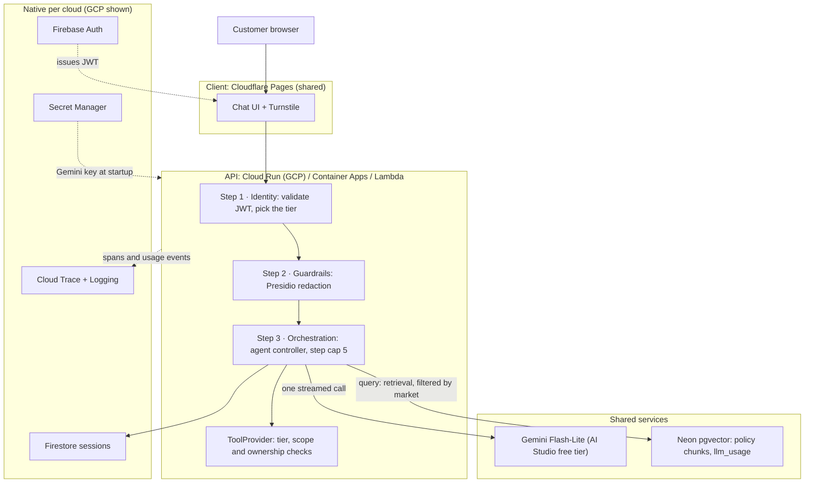
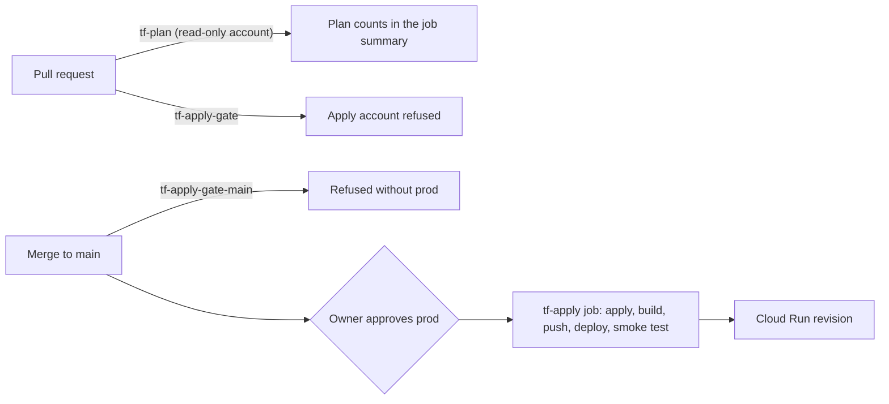

# Design: Spanish support chatbot

Nov 1, 2026 · @Victor Ramirez · Status: living document, first version (M1)

This doc explains how the system works and why it is shaped this way. Scope and schedule live in
the [roadmap](roadmap.md); individual decisions live in the [ADRs](adr/README.md). Each section
says what is **live** today and what is **designed** but not built yet.

## 1. Problem

A bank serving Spanish speakers in the US, Mexico, Colombia, El Salvador, Peru and Spain wants a
support assistant that:

- answers from **that market's** policy documents, with sources, in regional Spanish
- takes simple account actions (card status, block a card, open a ticket), but only with proof of
  identity and an explicit confirmation
- hands off to a human when it is unsure

The bank is fictional and every customer record is synthetic. The system has to cost **$0 to
run** and work the same way on GCP, Azure and AWS, with only adapters changing between clouds.

## 2. Requirements

The full table, with the milestone that delivers each requirement, is in the
[roadmap](roadmap.md#requirements). The ones that shape the design most:

| Requirement | Target | What it forces |
| --- | --- | --- |
| Answers start fast | First token in under 3 s | One model call on the hot path, no router model, thinking off |
| Identity | JWT checked on every call; three tiers | An identity layer in front of everything, not bolted onto tools |
| Privacy | No PII reaches the model | Redaction right after the token check, before any other step sees the text |
| Cost visibility | Tokens per call by cloud, model and purpose | Usage recorded inside the `LLMProvider` adapter, not in callers |
| Scale | 50k conversations a day | Stateless serving that scales out; state in a session store |
| Cost to run | $0 | Serverless, scale to zero, always-free tiers only |
| Portability | Same app on three clouds | A cloud-free core behind ports ([ADR 0001](adr/0001-monorepo.md)) |

## 3. Architecture

The client, guardrails, orchestration, model and knowledge layers are shared by every cloud.
Identity, serving, sessions, telemetry and secrets are native to each cloud, behind adapters.

The per-cloud mapping of every layer is in the [roadmap](roadmap.md#architecture-decisions).

**Rules that keep it portable** (enforced in CI, not just documented):

- `core/` never imports a cloud SDK, the web framework or the adapters (`import-linter`).
- Each port (`LLMProvider`, `IdentityProvider`, `SessionStore`, `ToolProvider`, ...) has one
  contract test suite that every adapter must pass.
- `apps/` are thin entry points with no business logic.

## 4. Online path: one chat request

**Live today (M1):** an anonymous `POST /v1/chat` reaches Cloud Run, the core adds a fixed Spanish
system prompt, and one Gemini call streams the answer back as server-sent events (`data:` deltas,
then `event: done`). On a provider failure the client gets a generic `model_unavailable` event, and
the log records only the error type and status code.

Each request is one trace in Cloud Trace:
- **`POST /v1/chat`** continues the browser's `traceparent`. It records the method, the route, the
  status code, the tier and the outcome (`done`, `error`, `incomplete` or `rejected`). It starts
  before the token check, so a refused token is still one trace, with its reason code.
- **`chat.model`** is its child. It records the model, the message length, the time to first token
  and the number of chunks.

Spans carry sizes and timings, never message text, and errors only by type. Log lines are JSON
with the trace ID, so Cloud Logging shows them under their trace.

Two details make every request appear:
- Cloud Run's front end marks most requests "not sampled", so that flag is not trusted.
- Spans are flushed before the request ends, while Cloud Run still allocates CPU.

FastAPI's built-in telemetry is off for both reasons: its span ends too late, and its logs can
include request text.

**Designed (M1 to M3):** each step below is one OpenTelemetry span, so time to first token breaks
down by stage.

| # | Step | Detail | Milestone |
| --- | --- | --- | --- |
| 1 | Edge | Turnstile token checked; the browser sends `traceparent` | M1 |
| 2 | Identity | JWT validated on **every** call; no token means the anonymous tier | M1 |
| 3 | Redaction | Presidio removes PII, including each market's ID numbers (SSN, CURP, cédula, DUI, DNI). Redaction events are logged by type, never by value | M3 |
| 4 | Session | Recent turns loaded from the session store | M3 |
| 5 | Retrieval | e5-small embeds the question (`query:` prefix); Neon returns 3 to 5 chunks, **always filtered by market** | M2 |
| 6 | Model | One streamed Gemini call; stable system prompt prefix for caching; thinking at minimal | M0 (live) |
| 7 | Tools | Only if the model asks: the tier, scope and ownership checks run before any tool | M3 |
| 8 | Output check | The model's output is scanned for PII as well | M3 |
| 9 | Usage | Tokens, model, `purpose`, `prompt_parts` and latency written async to `llm_usage` | M1 |

A question that needs no tool costs **one model call**, with no router model in front of it.
Agent loops that do need tools are capped at 5 steps.

## 5. Identity and access

The tier is decided from the validated token on each call, never from the conversation.

| Tier | How you get it | What you can do |
| --- | --- | --- |
| Anonymous | No token | Policy answers only |
| Signed in | Valid JWT (email sign-in) | Read-only tools, e.g. card status |
| Step-up | Signed in **and** `auth_time` within the last 5 minutes (email code or re-login) | Action tools, e.g. block a card, open a ticket |

Rules every tool follows:

- It checks the caller's scope and that the account belongs to the caller's `sub`.
- Action tools need an explicit "yes" from the user, and write an audit record: who, what, when,
  and the decision.
- The model never sees tokens. Tools return masked data only, e.g. "card ending 4417".
- Staff copilots reach the same tools over MCP in M9, with the same checks. MCP tool descriptions
  and results are treated as untrusted input and pass through the guardrails.

**Live today:** the token check runs on every `POST /v1/chat`, behind the `IdentityProvider`
port.
- **No `Authorization` header** gives the anonymous tier.
- **A token must pass every check** to count:
  - RS256 only, with a key from Google's published Firebase keys
  - issuer and audience equal to the project
  - not expired
  - `sub` and `auth_time` present, and `auth_time` not in the future
- **Anything else gets a 401 before anything streams.** The log records only a reason code,
  never the token.
- **The token stops at the API.** The chat service and the model see only the message.
- **The tier rule lives in `core/identity.py`**, so it's the same on every cloud: step-up means
  signed in within the last 5 minutes. Tools that use the tiers arrive in M3.
- **The JWT checker is generic** (`adapters/shared/jwt_identity.py`). Firebase supplies only its
  key URL, issuer and audience; Entra and Cognito will do the same in M7 and M8.
- **Signing in** (Firebase email sign-in) is turned on with the chat UI
  ([#22](https://github.com/ramirez-ai-labs/spanish-support-chatbot/issues/22)), the first thing
  that signs anyone in.

## 6. Offline path

Designed, not built yet:

- **Indexing (M2):** one pipeline chunks each market's policy docs, embeds them with e5-small
  (`passage:` prefix), and writes them to Neon with their market tag. Apps only read.
- **Evals (M4):** per-market test sets run in CI. A worse prompt, model or index fails the
  build. The eval code comes from the existing lab repos, installed from pinned tags.

## 7. Infrastructure and delivery (live)

Everything is Terraform, applied by CI. Consoles are for looking only.

- **Keyless CI login.** GitHub's OIDC token is exchanged through Workload Identity Federation.
  Google trusts it only for this repository, pinned by numeric repo and owner IDs.
- **Two accounts.**
  - `tf-plan` is read-only and runs on every PR.
  - `tf-apply` is trusted only for jobs on `main` in the approval-gated `prod` environment.
  - Google checks the environment, not just GitHub, so a modified workflow file can't skip it.
- **Least privilege.**
  - `tf-apply` has specific roles instead of editor.
  - It can manage secret containers but never read or add secret values.
  - It can grant only a fixed list of runtime roles. A CI test proves that owner, editor, IAM
    admin, token creator and project-wide secret access are refused.
- **Secrets.** Terraform creates the empty `gemini-api-key` container. The owner pipes the value in
  once from `.env`. Only the runtime account `chatbot-run` can read it. Terraform never handles
  secret values, because state is readable by the plan account.
- **Split ownership of the service.** Terraform owns Cloud Run's settings: limits, identity, env,
  secret references. CI owns the image. Terraform ignores image changes, so an apply never rolls
  back a deploy, and rollback is a traffic shift to the last good revision.
- **One approval per merge.** The approved job applies the stack, builds `api:<commit>`, pushes it,
  deploys it and smoke tests `/health` and one real Spanish answer.
- **Public logs.**
  - Project values are Actions *secrets*, which GitHub masks. Variables are never masked.
  - The project number and the service URL are masked explicitly.
  - Plans publish only their counts.
- **Audit.** Data Access logs on the token-exchange APIs record every CI login, including
  refused ones.

The full procedure and the security test layers are in [BOOTSTRAP.md](../infra/BOOTSTRAP.md).

## 8. Cost and scale

**$0 today.** Everything runs on always-free tiers:

| Service | Free tier | Our use |
| --- | --- | --- |
| Cloud Run (request-based) | 2M requests, 180k vCPU-s, 360k GiB-s a month | Scale to zero, max 1 instance |
| Artifact Registry | 0.5 GB | 3 newest images kept |
| Secret Manager | 6 versions, 10k accesses a month | 1 version |
| Gemini (AI Studio) | Free tier, key in a project with **no billing** | It returns 429 at the limit instead of billing |

Separately, $1 budget alerts and spend caps catch surprises.

**Scale target, as arithmetic.** These are assumptions, to be checked by the M5 load test.

| Quantity | Value |
| --- | --- |
| Conversations a day | 50,000 |
| Turns per conversation (assumed) | 4 → 200k requests a day, 2.3 a second on average |
| Peak factor (assumed) | 5× → about 12 requests a second |
| Stream open per answer (assumed) | about 5 s → about 60 concurrent streams |
| Concurrency per instance (configured) | 20 → **about 3 instances at peak** |

So serving scales out easily. The binding limits are elsewhere:

- The **Gemini free-tier quota** is far below that load. Production would move to a paid tier
  (Vertex AI or a billed key) behind the same `LLMProvider` port.
- **200k requests a day** is about 6M a month, over Cloud Run's free tier. The target is
  load-tested, not run daily.
- The demo caps Cloud Run at **1 instance**, to bound cost and blast radius.

**Cost visibility (M1, M5):** every call records its tokens and purpose. Cost is computed at query
time from a dated `model_prices` table, never hardcoded. That shows a production "shadow cost" even
while the bill is $0.

## 9. Tradeoffs

| Decision | Chosen | Alternative | Why |
| --- | --- | --- | --- |
| Serving | Serverless containers ([ADR 0004](adr/0004-serverless-containers-not-kubernetes.md)) | GKE / AKS / EKS | $0 when idle, no cluster work; Kubernetes wins with many services and steady load |
| Model | Gemini Flash-Lite, free tier, every cloud ([ADR 0003](adr/0003-gemini-on-every-cloud.md)) | Each cloud's native model | One quality bar across clouds, $0; 0.5 s to first token vs over a minute on Flash |
| Knowledge | One shared Neon pgvector ([ADR 0002](adr/0002-shared-neon-knowledge-layer.md)) | Native vector store per cloud | Same answers and citations everywhere, one index; costs a cross-cloud network hop |
| Repo | Monorepo, cloud-free core ([ADR 0001](adr/0001-monorepo.md)) | Repo per cloud | "Only adapters change" can be checked in CI |
| Delivery | Thinnest working slice ([ADR 0005](adr/0005-something-runs-every-day.md)) | Infrastructure first | Always something to demo; some rework inside adapters |
| Who owns the service | Terraform: settings; CI: image | All in Terraform, or all in CI | Declarative settings without Terraform rolling back deploys |
| Secret values | Added by hand, read only by the runtime account | Created by Terraform or CI | State and CI logs never hold the key |
| Endpoint exposure | Public, tiers enforced in the app | Private behind IAP or an API gateway | Anonymous visitors are a real tier; abuse is limited by Turnstile (M1) and rate limits (M5) |
| Deploy gate | One approval covers apply and deploy | Separate approvals | One click per merge; the gate is still enforced by Google, not just GitHub |
| Hot path | One model call, no router | Router model plus a specialist | Lower latency and cost; tool use handles the cases a router would |

## 10. Risks and open questions

- **Public endpoint before Turnstile.** Anyone with the URL can use up the free Gemini quota.
  It can't cost money, because the key's project has no billing. Closed by Turnstile
  ([#22](https://github.com/ramirez-ai-labs/spanish-support-chatbot/issues/22)) and rate limits (M5).
- **Free-tier churn.** Models leave the free tier or close to new keys without notice. The
  adapter isolates it, and the M4 bakeoff reruns when models change.
- **Shared Neon** is one failure point and one connection budget for three clouds. It's
  acceptable for a demo; the M6 version of this doc describes the production alternative.
- **Cold starts** land on the first request after idle. M5 measures them and decides on
  warm-up pings or startup CPU boost.
- **Owner account.** The `prod` approval is only as strong as the owner's GitHub login. MFA is
  tracked in [#36](https://github.com/ramirez-ai-labs/spanish-support-chatbot/issues/36).
